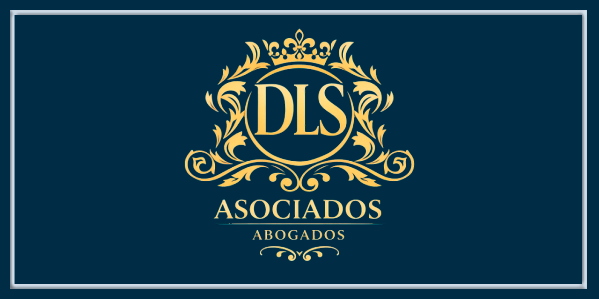

# Sitio web DLS Asociados Abogados

Sitio web institucional estático para el Estudio Jurídico DLS Asociados Abogados, ubicado en Tarija, Bolivia.

---

---

 

---

## ✨ Funcionalidades

- Presentación institucional del estudio jurídico
- Áreas de práctica: Penal, Civil, Familia, Niñez, Laboral, Administrativo, Constitucional, Empresarial
- Carrusel de profesionales con fotografías reales
- Formulario de contacto con envío vía WhatsApp
- Mapa de ubicación en Tarija, Bolivia
- Diseño responsive para escritorio, tablet y móvil
- Accesibilidad WCAG 2.2 AA (skip link, ARIA, foco visible, contraste)
- SEO: Open Graph, Twitter Cards, JSON-LD (LegalService), sitemap.xml, robots.txt
- Imágenes optimizadas en WebP con lazy loading y srcset/sizes

## 🚀 Despliegue

Sitio estático. No requiere compilación ni servidor.

1. Sube la carpeta completa a tu servidor estático (Netlify, Vercel, GitHub Pages, etc.)
2. O conecta el repositorio de GitHub para despliegue automático
3. La URL base es la raíz del sitio (`/`)
4. URL en producción: https://dls-asociados-abogados.netlify.app/

### Estructura de archivos

| Archivo/Carpeta | Descripción |
|-----------------|-------------|
| `index.html` | Página principal con todas las secciones |
| `terms-of-service.html` | Términos y Condiciones de Uso |
| `privacy-policy.html` | Política de Privacidad |
| `css/tokens.css` | Variables de diseño: colores, tipografía, breakpoints |
| `css/base.css` | Reset, tipografía, utilidades, botones, accesibilidad |
| `css/components.css` | Componentes: header, hero, áreas, equipo, contacto, footer |
| `css/responsive.css` | Adaptación tablet y móvil |
| `js/main.js` | Punto de entrada, inicializa módulos |
| `js/navigation.js` | Menú móvil, scroll del header, enlaces activos |
| `js/reveal.js` | Animaciones al hacer scroll (IntersectionObserver) |
| `js/contact-form.js` | Validación y enlace a WhatsApp |
| `js/carousel.js` | Carrusel de profesionales con indicadores |
| `js/social-float.js` | Panel flotante de redes sociales |
| `js/year.js` | Año dinámico del copyright |
| `js/map.js` | Módulo para mapa con Leaflet |
| `js/theme.js` | Tema removido (conservado por compatibilidad) |
| `js/config.js` | Configuración centralizada |
| `sitemap.xml` | Mapa del sitio para motores de búsqueda |
| `robots.txt` | Directivas de rastreo |
| `_headers` | Encabezados de seguridad para Netlify |
| `assets/logo/` | Logotipo, isotipo y apple-touch-icon |
| `assets/images/equipo/` | Fotografías de los profesionales |
| `assets/images/oficina.webp` | Fotografía de la oficina |
| `assets/images/mapa.webp` | Imagen de ubicación |

## 🧩 Tecnologías

- HTML5 semántico
- CSS3 modular
- JavaScript nativo (ES Modules)
- Google Fonts: Cormorant Garamond (títulos), Inter (cuerpo)

## ♿ Accesibilidad

- Skip link para saltar al contenido
- Atributos ARIA en botones, menú y carrusel
- Indicador de foco visible
- Contraste de color WCAG 2.2 AA
- Navegación por teclado
- Preferencia de movimiento reducido (`prefers-reduced-motion`)

## 📊 Estado del proyecto

**Estado: Estable, listo para despliegue en producción.**

- [x] Sitio estático completo y funcional
- [x] Carrusel de profesionales con 7 integrantes
- [x] Formulario de contacto vía WhatsApp
- [x] Páginas legales (Términos y Privacidad)
- [x] SEO con Open Graph y datos estructurados
- [x] Imágenes optimizadas y lazy loading
- [x] Diseño responsive en todos los breakpoints
- [x] Accesibilidad WCAG 2.2 AA

## 📌 Repositorio

[github.com/Pablitus666/Estudio---Juridico](https://github.com/Pablitus666/Estudio---Juridico)

---

## 👨‍💻 Autor

**Walter Pablo Téllez Ayala**  
Software Developer  
📍 Bolivia 🇧🇴   
📧 pharmakoz@gmail.com

© 2026 — **Estudio Juridico**

---

## Modelo de sitio — versión 1.0

Primera versión del sitio web institucional del Estudio Jurídico DLS Asociados Abogados.

### Secciones incluidas

- Hero con presentación y llamada a acción
- El estudio (oficina y descripción)
- Áreas de práctica (9 especialidades jurídicas)
- Profesionales (7 integrantes con fotografías)
- Contacto (formulario, WhatsApp, dirección, horarios)
- Pie de página con enlaces y redes sociales

### Tecnologías del sitio

- HTML5, CSS3, JavaScript ES Modules
- Diseño oscuro con paleta institucional (azul tinto, burdeo, piedra)
- Tipografía: Cormorant Garamond y Inter

### Licencia

Este sitio es propiedad del Estudio Jurídico DLS Asociados Abogados, Tarija, Bolivia.
